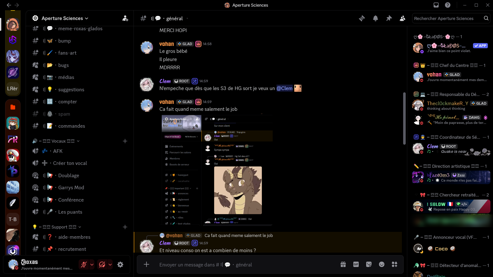
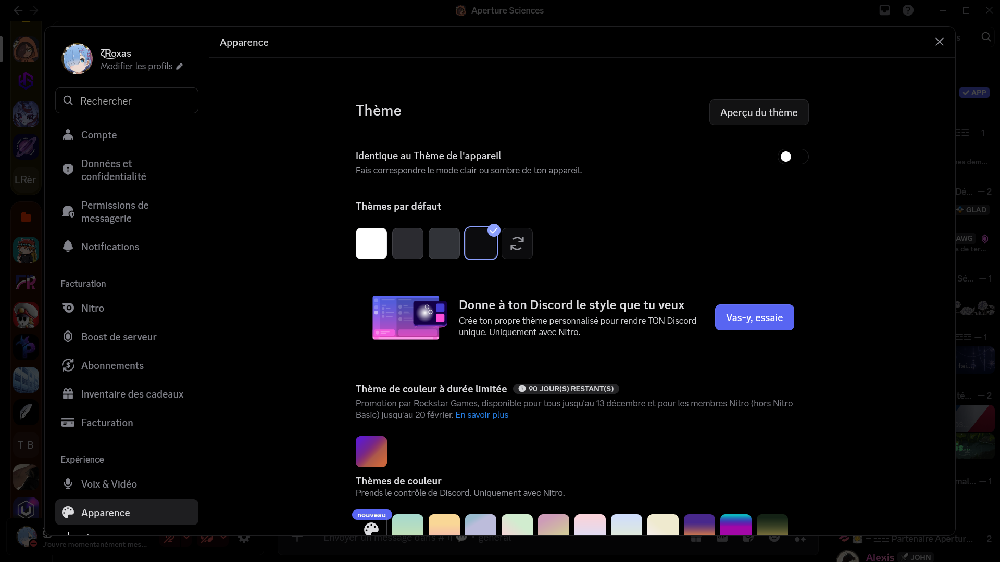

<p align="center">
  
</p>

<h1 align="center">Discord Phoenix</h1>

<p align="center">
  A native Discord desktop client written in Rust and rendered on the GPU with <a href="https://gpui.rs">GPUI</a>.<br>
  No Electron, no Chromium, no JavaScript runtime.
</p>

<p align="center">

  <a href="https://github.com/RoxasYTB/project-phoenix/releases"></a>
  
  
</p>

> [!WARNING]
> **Discord Phoenix is not affiliated with, endorsed by, or sponsored by Discord Inc.**
> "Discord" and the Discord logo are trademarks of Discord Inc. This is an independent, unofficial project.
> Third-party clients are not permitted by Discord's Terms of Service, and using one can lead to your
> account being limited or terminated. You use this software at your own risk.

## Why

The official desktop client is a web application shipped inside Electron. Discord Phoenix reimplements it
as a native application with the goals of:

- **Looking and behaving like the official client**, so there is nothing new to learn.
- **Using far less memory and CPU**, by rendering with the GPU and keeping only what is on screen alive.
- **Reliable audio/video.** Camera and screen share can run at the same time. The client never sends
  H.265/HEVC and only negotiates encodings that decode correctly on Windows, Linux, macOS, iOS and Android
  peers (AV1, H.264 4:2:0 8-bit, VP8), falling back to another codec instead of crashing when an encoder fails.

## Status

Beta, under active development. The goal is a 1:1 visual and functional replica of the official 2026 desktop client. Every area is compared against the real client on a real account: same window size, zoom and states (hover, focus, pressed, open menus). The per-area tables in [docs/parity/](docs/parity/) currently list about 1,450 verified rows, 95 partial and 24 missing.

### Done

- **Core**: token login with the token kept in the system keyring, gateway with compression, resume and reconnect, REST with rate limiting, local state cache.
- **Navigation**: server rail with folders, unread and mention badges, Favorites server, channel list with categories, threads and mute rules, DMs and group DMs, Friends page, message requests, Nitro home, Shop.
- **Chat**:
  - the message list with grouping rules, date and "new messages" dividers, jump to a message with a highlight, and the detached history view;
  - the send lifecycle: pending message, failed state, retry, slowmode;
  - editing and deleting messages, replies and reactions.
- **Message content**: Discord markdown (masked links, code blocks with highlighting, spoilers), mentions, Twemoji 16.0 emoji, animated emoji, GIFs and stickers, embeds and provider layouts, attachments with an image viewer, polls, components v2, voice messages, system messages.
- **Composer**: the + menu, uploads (picker, drag and drop, paste) with progress and spoiler/description, emoji, GIF and sticker pickers, the app launcher, typing indicator.
- **Members and profiles**: member list identical to the client (per-channel lists, Activity section, role groups, nameplates), profile popout and modal, avatar decorations above the status mask.
- **Search**: server and DM search with filters, sort, pagination and highlighted hits.
- **Threads and forums**: create, join, leave, rename, archive, lock, private threads, thread browser, forum sort and tag filters.
- **Settings**: account, privacy and data, notifications, appearance (themes Light, Ash, Dark, Onyx, high contrast, density, font size, zoom), synced and local settings wired like the client, subscriptions.
- **Voice**: voice channels with mute and deafen states, soundboard, camera (sending), notification and call sounds.
- **Desktop**: custom title bar, tray icon, autostart, hardware acceleration toggle, keyboard shortcuts, responsive layout down to narrow windows.
- **Reporting**: the multi-step report flow for messages.

### Still to do

- [ ] Screen share (Go Live): sending and watching streams (in progress)
- [ ] Receiving other people's camera video, tested with a second account
- [ ] Activities: they are web apps, and Phoenix has no web engine yet
- [ ] End-to-end encrypted calls (DAVE), tested in a channel that has it enabled
- [ ] Mentions that contain emoji should render as one continuous pill
- [ ] Underlines over mixed-height glyphs (CJK, emoji) should be one uniform line
- [ ] Clickable names in replies; mutual friends and servers that open the full profile
- [ ] Rounded profile popout corners
- [ ] Fades on a few voice message controls
- [ ] Empty states and scrollbars of some popouts and modals
- [ ] Settings that are stored but have no effect yet, such as streamer mode detection and text-to-speech (see [settings-wiring](docs/parity/settings-wiring.md))
- [ ] The remaining ⚠ and ❌ rows in [docs/parity/](docs/parity/)

Contributions are very welcome, especially on the items above. Pick an unchecked item or a ❌ row, compare it with the official client, and open a PR; see [Contributing](#contributing).

## Development progress

**<u>THESE SCREENSHOTS ARE NOT FINAL VERSIONS.</u>**

These are real, unedited renders of Phoenix logged into a real account on the project's own community server, *Aperture Sciences* (24 November 2026, build `1f295c9`). One third-party nickname is blurred. Nothing here is a mock-up: the messages, members, roles, badges, nameplates, server rail and channel list come live from Discord's gateway and API, and Phoenix draws them natively with Rust + GPUI.





How we check parity: every view is compared against the official 2026 client on the same account, at the same window size and zoom. We measure the CSS, the states (hover, focus, pressed, open menus) and the window widths at which the layout changes. The method is in [docs/PARITY_WORKFLOW.md](docs/PARITY_WORKFLOW.md), and each area has a status table in [docs/parity/](docs/parity/), with ✅, ⚠ and ❌ and the source of each value.

## Benchmarks

First measurements (i7-6700K, GTX 1050 Ti, 32 GB, Wayland). Discord Phoenix ran on **mock data**,
while the official client was measured read-only on a **real account**, so treat this as an
order of magnitude. Full method and caveats: [docs/BENCHMARKS.md](docs/BENCHMARKS.md).

| | Discord Phoenix (mock) | Official Discord 1.0.170 |
|---|---|---|
| Idle memory (PSS) | ~140–195 MiB, 1 process | ~805 MiB, 10 processes |
| Idle CPU | ~0.3 % of one core | ~2.2 % |
| Start to first frame | ~0.5 s warm, 1.2 s cold | — |
| 5000-message channel | +14 MiB after loading and scrolling it all | — |
| Binary | 42 MiB, single stripped file | Electron |

Reproduce with `scripts/bench/run.sh`.

## Installing

Prebuilt beta builds for Linux (AppImage, `.deb`, tarball), Windows and macOS are attached to
[releases](https://github.com/RoxasYTB/project-phoenix/releases). macOS builds are not notarized:
right-click the app and choose **Open** the first time.

## Building from source

Requires a recent stable Rust toolchain (`rustup`).

```sh
git clone https://github.com/RoxasYTB/project-phoenix
cd project-phoenix
cargo run -p phoenix-app --release
```

**Linux** also needs these development packages (Debian/Ubuntu names):

```sh
sudo apt install pkg-config libxkbcommon-dev libxkbcommon-x11-dev libwayland-dev \
  libvulkan-dev libxcb1-dev libfontconfig-dev libssl-dev libasound2-dev
```

**macOS** needs the Xcode command line tools. **Windows** needs the MSVC build tools.

## Project layout

| Crate | Purpose |
|---|---|
| [`phoenix-api`](crates/phoenix-api) | Data models, REST client with rate limiting, gateway connection, state cache |
| [`phoenix-voice`](crates/phoenix-voice) | Voice gateway, UDP/RTP transport, encryption, codec negotiation, DAVE |
| [`phoenix-app`](crates/phoenix-app) | The GPUI desktop application |

## Privacy and security

Your token is only ever sent to Discord. The client has no telemetry and no analytics.
See [SECURITY.md](SECURITY.md) for how credentials are handled and how to report a vulnerability.

## Contributing

Contributions are welcome, from a one-pixel fix to a whole feature. Please read [CONTRIBUTING.md](CONTRIBUTING.md) first; the parity tables in [docs/parity/](docs/parity/) show what is missing and how each value was measured. In short: everything is
aimed at 1:1 parity with the official client. The real client's CSS, behaviour and assets are the reference.
Binary assets are loaded from your local Discord install and are not shipped in this repository.

## License

Licensed under either of [Apache License 2.0](LICENSE-APACHE) or [MIT License](LICENSE-MIT), at your option.
