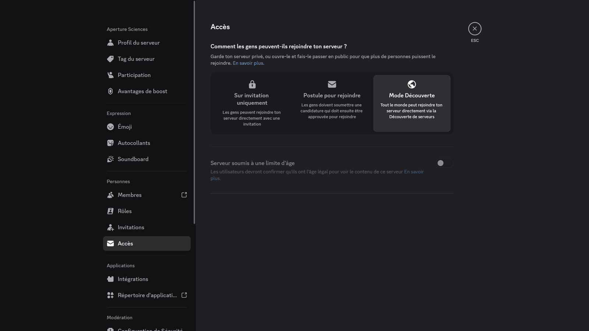

<p align="center">
  
</p>

<h1 align="center">Discord Phoenix</h1>

<p align="center">
  A native Discord desktop client written in Rust and rendered on the GPU with <a href="https://gpui.rs">GPUI</a>.<br>
  No Electron, no Chromium, no JavaScript runtime.
</p>

<p align="center">

  <a href="https://github.com/RoxasYTB/project-phoenix/releases"></a>
  
  
  <a href="https://discord.gg/uF3wtckHkN"></a>
</p>

<p align="center"><b><a href="https://discord.gg/uF3wtckHkN">Join the community on Discord</a></b></p>

> [!WARNING]
> **Discord Phoenix is not affiliated with, endorsed by, or sponsored by Discord Inc.**
> "Discord" and the Discord logo are trademarks of Discord Inc. This is an independent, unofficial project.
> Third-party clients are not permitted by Discord's Terms of Service, and using one can lead to your
> account being limited or terminated. You use this software at your own risk.

<p align="center">
  
</p>

## Why

The official desktop client is a web application shipped inside Electron. Discord Phoenix reimplements it
as a native application with the goals of:

- **Looking and behaving like the official client**, so there is nothing new to learn.
- **Using far less memory and CPU**, by rendering with the GPU and keeping only what is on screen alive.
- **Reliable audio/video.** Camera and screen share can run at the same time. The client never sends
  H.265/HEVC and only negotiates encodings that decode correctly on Windows, Linux, macOS, iOS and Android
  peers (AV1, H.264 4:2:0 8-bit, VP8), falling back to another codec instead of crashing when an encoder fails.

## Status

Beta, under active development. Every screen is compared side by side with the official 2026 client
(same size, same zoom, same account) and measured values come from the client's own CSS. The parity
tables in [`docs/parity/`](docs/parity) track about 1,950 checked items.

| Area | State | Notes |
|---|---|---|
| Login | Works | Email and password, TOTP, SMS and backup codes, QR code login, token. The token stays in the system keyring. |
| Gateway and start-up | Works | Compression, resume, reconnect. The last session is cached on disk, so the UI is on screen in 0.1 to 0.4 s after launch. |
| Servers, channels, folders | Works | Rail with folders and badges, Favorites, categories, Browse Channels, Server Guide, onboarding and join gates. |
| Messages | Works | Markdown, Twemoji, animated emoji and stickers, embeds, image mosaics, polls, components, forwarded messages, system messages. |
| Composer | Mostly works | Rich editor with live markdown, slash commands, autocomplete, uploads, voice messages, polls, scheduled messages. |
| Threads and forums | Works | Thread browser, private threads, forum list and gallery views, tags, guidelines. |
| DMs, group DMs, calls | Mostly works | Friends, message requests, group DMs, ringing and incoming calls, call view above the DM. |
| Voice, video, screen share | Partial | Real voice, push-to-talk, noise suppression, soundboard, camera and Go Live sending, stream viewing. DAVE is implemented but not verified yet. |
| Members and profiles | Works | Role groups, Activity section, nameplates, server tags, profile popout and full profile with themes, effects and widgets. |
| Inbox, search, pins | Works | Unreads, Mentions, Saved, Reminders and Scheduled; search with filters, sort and pagination. |
| User settings | Mostly works | The 2026 settings modal with search, synced through Discord's settings protocol. Account changes are blocked on purpose for now. |
| Server and channel settings | Mostly works | The 2026 layout: roles, members, invites, AutoMod, audit log, bans, onboarding, channel permissions and webhooks. |
| Moderation | Mostly works | Mod View, timeout, kick and ban, report flows, View Server As Role. |
| Discover, Quests, Shop, Nitro | Partial | Real data is shown; nothing can be bought. |
| Notifications | Works | Desktop notifications with the client's rules, taskbar badge, tray icon, sound effects. |
| Themes, zoom, languages | Works | Light, Ash, Dark, Onyx, high contrast, density, font size, page zoom, English and French plus the client's own translations. |
| Platforms | Mostly works | Linux (AppImage, `.deb`, tarball), Windows and macOS builds, built-in updater. Linux is the most tested. |

## Features

**Servers and navigation**
- Server rail with folders, unread and mention badges, voice badge and drag reordering.
- Channel list with categories, mute dimming, private channel locks and threads under their channel.
- Resizable channel list and the client's narrow-window breakpoints.
- Quick switcher (Ctrl+K), the client's keyboard shortcuts and the shortcuts modal.
- Add Server with templates, invite dialogs, Server Guide, onboarding, rules screening and verification gates.
- Server events and the three-step create event wizard.

**Messages and composer**
- Discord markdown: headings, lists, quotes, subtext, masked links, spoilers, timestamps, highlighted code blocks.
- Animated GIFs, WebP, Lottie stickers, avatar decorations, image mosaics with the client's geometry.
- Embeds, components v2, bot buttons and selects, polls with live results, invite cards.
- Replies, forwards, reactions, reminders, Mark As Unread and full context menus.
- Rich editor that styles markdown while you type, also used to edit messages.
- Slash commands, mention, channel, emoji and sticker autocomplete.
- Uploads by picker, drag and drop or paste, with ALT text and spoiler options.
- Emoji, GIF and sticker pickers; voice messages; scheduled messages and scheduled polls.
- Announcement post composer and the Follow modal.

**Threads and forums**
- Threads popout, All Active Threads, private threads, archive, lock and timed mutes.
- Forums in list or gallery view, with tags, sort, guidelines and the post reactions bar.

**DMs and calls**
- Friends page, message requests, group DMs with face piles, friend nicknames as DM names.
- Ringing, incoming call popup, call view above the DM and call system messages.

**Voice and video**
- Voice channels with real audio, ping and connection stats, privacy codes.
- Push-to-talk, noise suppression, input profiles, per-user volume.
- Call view with tiles, spotlight, side chat, picture-in-picture and a popout window.
- Camera and Go Live (screen or window) with AV1, H.264 or VP8. H.265 is never sent.
- Quality changes without restarting the stream; soundboard and emoji effects.

**Members and profiles**
- Member list with role groups, Activity section, nameplates, role icons and server tags.
- Profile popout and full profile: Nitro themes, effects, frames, widgets, game collection, mutuals, notes.
- Status bubble toolbar and the client's friend buttons.
- Profile editor, custom status, server and friend nicknames.

**Search, inbox and moderation**
- Server and DM search with filters, sort, pagination and highlighted hits.
- Inbox with Unreads, Mentions, Saved, Reminders and Scheduled.
- Mod View, AutoMod rules, audit log, bans, report flows.

**Settings and desktop**
- The 2026 settings modal with page search, synced with your other clients.
- Appearance, accessibility, notifications, voice and video, language, Streamer Mode, keybinds.
- Server and channel settings on the 2026 layout.
- Discover, Quests, Shop, Nitro and Server Boost pages with real data.
- Desktop notifications, taskbar badge, tray icon, sound effects, Lottie hover animations.
- Icons, fonts and sounds are loaded from your local Discord install, never shipped.

**Known gaps**
- Receiving other people's camera and streams has not been checked with a second account yet.
- DAVE end-to-end encryption is written but not tested in a channel that requires it.
- No Activities and no built-in video player.
- Account changes (email, phone, password, username, 2FA) and purchases are blocked on purpose.

## Screenshots

Rendered by Discord Phoenix itself on a real account, offscreen at 1.5x scale, in the Aperture Sciences server.
Some third-party names are blurred. Captured on 2026-11-25 and 26 from main at `cf83f562` to `594490f1`.

### Chat

<table>
<tr>
<td width="50%" valign="top"><br><sub>Text channel with replies, attachments, server tags and the member list</sub></td>
<td width="50%" valign="top"><br><sub>Link embeds, member list with role groups and activities</sub></td>
</tr>
<tr>
<td width="50%" valign="top"><br><sub>Announcement channel with the Follow button and reactions</sub></td>
<td width="50%" valign="top"><br><sub>Pinned messages popout</sub></td>
</tr>
<tr>
<td width="50%" valign="top"><br><sub>Threads popout</sub></td>
<td width="50%" valign="top"><br><sub>Search results with highlights, filters and pages</sub></td>
</tr>
</table>

### Forums

<table>
<tr>
<td width="50%" valign="top"><br><sub>Forum channel with pinned and older posts</sub></td>
<td width="50%" valign="top"><br><sub>Forum tags and post previews</sub></td>
</tr>
</table>

### Composer and pickers

<table>
<tr>
<td width="50%" valign="top"><br><sub>Emoji picker with the server's popular emojis</sub></td>
<td width="50%" valign="top"><br><sub>GIF picker</sub></td>
</tr>
<tr>
<td width="50%" valign="top"><br><sub>Sticker picker</sub></td>
<td width="50%" valign="top"><br><sub>Create a poll</sub></td>
</tr>
</table>

### Menus

<table>
<tr>
<td width="50%" valign="top"><br><sub>Message context menu</sub></td>
<td width="50%" valign="top"><br><sub>Channel context menu</sub></td>
</tr>
<tr>
<td width="50%" valign="top"><br><sub>Server context menu</sub></td>
<td width="50%" valign="top"><br><sub>Server dropdown</sub></td>
</tr>
<tr>
<td width="50%" valign="top"><br><sub>User panel and status popout</sub></td>
</tr>
</table>

### Voice

<table>
<tr>
<td width="50%" valign="top"><br><sub>Call view in a voice channel</sub></td>
</tr>
</table>

### Inbox and moderation

<table>
<tr>
<td width="50%" valign="top"><br><sub>Inbox, Mentions tab</sub></td>
<td width="50%" valign="top"><br><sub>Inbox, Unreads tab</sub></td>
</tr>
<tr>
<td width="50%" valign="top"><br><sub>Mod View</sub></td>
</tr>
</table>

### Dialogs

<table>
<tr>
<td width="50%" valign="top"><br><sub>Follow an announcement channel</sub></td>
<td width="50%" valign="top"><br><sub>Create event wizard</sub></td>
</tr>
<tr>
<td width="50%" valign="top"><br><sub>Add a server, with templates</sub></td>
<td width="50%" valign="top"><br><sub>Invite dialog</sub></td>
</tr>
<tr>
<td width="50%" valign="top"><br><sub>Server notification settings</sub></td>
<td width="50%" valign="top"><br><sub>Server Boost layer</sub></td>
</tr>
<tr>
<td width="50%" valign="top"><br><sub>Server Guide</sub></td>
<td width="50%" valign="top"><br><sub>Discover</sub></td>
</tr>
<tr>
<td width="50%" valign="top"><br><sub>Discover, Apps</sub></td>
<td width="50%" valign="top"><br><sub>Quests</sub></td>
</tr>
</table>

### User settings

<table>
<tr>
<td width="50%" valign="top"><br><sub>Appearance</sub></td>
<td width="50%" valign="top"><br><sub>Voice & Video</sub></td>
</tr>
<tr>
<td width="50%" valign="top"><br><sub>Notifications</sub></td>
<td width="50%" valign="top"><br><sub>Accessibility</sub></td>
</tr>
<tr>
<td width="50%" valign="top"><br><sub>Language & Time</sub></td>
<td width="50%" valign="top"><br><sub>Developer</sub></td>
</tr>
<tr>
<td width="50%" valign="top"><br><sub>Activity Privacy</sub></td>
<td width="50%" valign="top"><br><sub>Registered Games</sub></td>
</tr>
<tr>
<td width="50%" valign="top"><br><sub>Content filters</sub></td>
<td width="50%" valign="top"><br><sub>Data & Privacy</sub></td>
</tr>
<tr>
<td width="50%" valign="top"><br><sub>Nitro</sub></td>
<td width="50%" valign="top"><br><sub>Server Boost</sub></td>
</tr>
<tr>
<td width="50%" valign="top"><br><sub>Gift Inventory</sub></td>
</tr>
</table>

### Server and channel settings

<table>
<tr>
<td width="50%" valign="top"><br><sub>Server profile</sub></td>
<td width="50%" valign="top"><br><sub>Server tag</sub></td>
</tr>
<tr>
<td width="50%" valign="top"><br><sub>Engagement</sub></td>
<td width="50%" valign="top"><br><sub>Boost perks</sub></td>
</tr>
<tr>
<td width="50%" valign="top"><br><sub>Emoji</sub></td>
<td width="50%" valign="top"><br><sub>Stickers</sub></td>
</tr>
<tr>
<td width="50%" valign="top"><br><sub>Soundboard</sub></td>
<td width="50%" valign="top"><br><sub>Roles</sub></td>
</tr>
<tr>
<td width="50%" valign="top"><br><sub>Integrations</sub></td>
<td width="50%" valign="top"><br><sub>Access</sub></td>
</tr>
<tr>
<td width="50%" valign="top"><br><sub>Channel settings</sub></td>
</tr>
</table>

### Themes and zoom

<table>
<tr>
<td width="50%" valign="top"><br><sub>Light theme</sub></td>
<td width="50%" valign="top"><br><sub>Ash theme</sub></td>
</tr>
<tr>
<td width="50%" valign="top"><br><sub>Onyx theme</sub></td>
<td width="50%" valign="top"><br><sub>125 % zoom</sub></td>
</tr>
<tr>
<td width="50%" valign="top"><br><sub>Narrow window (900 px)</sub></td>
<td></td>
</tr>
</table>


## Benchmarks

Measured on 2026-11-25 against the official client 1.0.171 on the same machine
(i7-6700K, GTX 1050 Ti, Wayland). Every process of each app is summed from `/proc`.
Full method and caveats: [docs/perf.md](docs/perf.md) and [docs/BENCHMARKS.md](docs/BENCHMARKS.md).

| | Official Discord 1.0.171 | Phoenix, real account (dev build) | Phoenix, release build (mock data) |
|---|---|---|---|
| Memory (PSS) | 880 to 963 MiB | **342 MiB** | **202 MiB** |
| Memory (RSS) | 1,427 to 1,504 MiB | 423 MiB | 287 MiB |
| Processes | 9 + crash handler | 1 | 1 |
| Threads | 138 | 18 | 23 |
| CPU at rest | 8 to 11 % of one core | 4.1 % | **0.45 %** |
| Wakeups per second | 243 to 303 | 186 | 127 |
| On disk | 560 MB install + 708 MB profile | | **55.9 MB** binary |

PSS counts shared pages once, so it is the fair number for memory: Phoenix uses 2.6 to 2.8 times
less than Discord on a real account, and 4.4 to 4.8 times less in the release build.
The CPU columns are not like for like (the real-account run is an unoptimized dev build).

| Start-up | |
|---|---|
| Session on screen after launch (resume from disk) | about 0.12 s after connecting |
| Cold start, live READY then first channel | 1.27 s, then 0.37 s |
| Cached channel switch | 8 to 15 ms from memory, about 0.1 s from disk |

Reproduce with `scripts/bench/run.sh`.

## Installing

Prebuilt beta builds for Linux (AppImage, `.deb`, tarball), Windows and macOS are attached to
[releases](https://github.com/RoxasYTB/project-phoenix/releases). macOS builds are not notarized:
right-click the app and choose **Open** the first time.

## Building from source

Requires a recent stable Rust toolchain (`rustup`).

```sh
git clone https://github.com/RoxasYTB/project-phoenix
cd project-phoenix
cargo run -p phoenix-app --release
```

**Linux** also needs these development packages (Debian/Ubuntu names):

```sh
sudo apt install pkg-config libxkbcommon-dev libxkbcommon-x11-dev libwayland-dev \
  libvulkan-dev libxcb1-dev libfontconfig-dev libssl-dev libasound2-dev
```

**macOS** needs the Xcode command line tools. **Windows** needs the MSVC build tools.

## Project layout

| Crate | Purpose |
|---|---|
| [`phoenix-api`](crates/phoenix-api) | Data models, REST client with rate limiting, gateway connection, state cache |
| [`phoenix-voice`](crates/phoenix-voice) | Voice gateway, UDP/RTP transport, encryption, codec negotiation, DAVE |
| [`phoenix-app`](crates/phoenix-app) | The GPUI desktop application |

## Privacy and security

Your token is only ever sent to Discord. The client has no telemetry and no analytics.
See [SECURITY.md](SECURITY.md) for how credentials are handled and how to report a vulnerability.

## Contributing

Questions, help and news are on the [project Discord server](https://discord.gg/uF3wtckHkN). Bugs are tracked only through GitHub issues.

Found a bug? Read [how to report it](docs/REPORTING_BUGS.md) ([en français](docs/SIGNALER_UN_BUG.md)): version, debug info, logs and screenshots, and what never to post.

Contributions are welcome, from a one-pixel fix to a whole feature. Please read [CONTRIBUTING.md](CONTRIBUTING.md) first; the parity tables in [docs/parity/](docs/parity/) show what is missing and how each value was measured. In short: everything is
aimed at 1:1 parity with the official client. The real client's CSS, behaviour and assets are the reference.
Binary assets are loaded from your local Discord install and are not shipped in this repository.

### Pull requests and issues need visual proof

Any change you can see needs before and after screenshots of the same view, at the same window size and scale.
Anything that moves (hover, animation, a menu opening, scrolling, video or GIF playback) also needs a before and after GIF.
A PR without them is not reviewed, unless it says it changes nothing visible.

Take them with the demo data, never with your own account, so that no names, messages or servers end up on GitHub:

```sh
# the app on demo data, to try the change by hand
PHOENIX_MOCK=1 PHOENIX_MOCK_AUTOLOGIN=1 cargo run -p phoenix-app

# offscreen render of the same view, on main ("before") and on your branch ("after")
PHX_W=1280 PHX_H=800 PHX_SCALE=1.5 cargo run -p phoenix-app --example screenshot -- after.png
```

For a GIF, add an input script with a `record` step, then convert the frames. See
[CONTRIBUTING.md](CONTRIBUTING.md#screenshots-and-gifs) for the details.

## License

Licensed under either of [Apache License 2.0](LICENSE-APACHE) or [MIT License](LICENSE-MIT), at your option.
