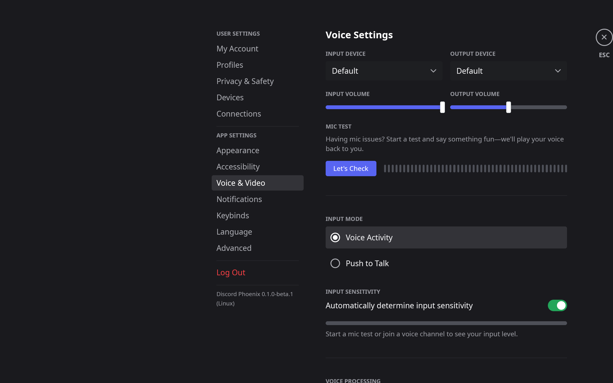

<p align="center">
  
</p>

<h1 align="center">Discord Phoenix</h1>

<p align="center">
  A native Discord desktop client written in Rust and rendered on the GPU with <a href="https://gpui.rs">GPUI</a>.<br>
  No Electron, no Chromium, no JavaScript runtime.
</p>

<p align="center">

  <a href="https://github.com/RoxasYTB/project-phoenix/releases"></a>
  
  
</p>

> [!WARNING]
> **Discord Phoenix is not affiliated with, endorsed by, or sponsored by Discord Inc.**
> "Discord" and the Discord logo are trademarks of Discord Inc. This is an independent, unofficial project.
> Third-party clients are not permitted by Discord's Terms of Service, and using one can lead to your
> account being limited or terminated. You use this software at your own risk.

## Why

The official desktop client is a web application shipped inside Electron. Discord Phoenix reimplements it
as a native application with the goals of:

- **Looking and behaving like the official client**, so there is nothing new to learn.
- **Using far less memory and CPU**, by rendering with the GPU and keeping only what is on screen alive.
- **Reliable audio/video.** Camera and screen share can run at the same time. The client never sends
  H.265/HEVC and only negotiates encodings that decode correctly on Windows, Linux, macOS, iOS and Android
  peers (AV1, H.264 4:2:0 8-bit, VP8), falling back to another codec instead of crashing when an encoder fails.

## Status

Beta: under active development. Expect missing features and bugs.

| Area | State |
|---|---|
| Login (token, email/password, TOTP) | In progress |
| Gateway (compression, resume, reconnect) | In progress |
| Servers, channels, DMs, messages, replies, reactions | In progress |
| Markdown, embeds, attachments | In progress |
| Member list, presence | In progress |
| Voice (Opus) | In progress |
| Camera and screen share | In progress |
| End-to-end encryption for calls (DAVE) | In progress |
| Settings, themes, notifications | In progress |

## Development progress

**<u>CES CAPTURES NE SONT PAS LES VERSIONS DÉFINITIVES.</u>**

The image below is a development snapshot of the Voice & Video settings screen. It is retained as a historical UI reference and does not claim that every control is wired in the current build. See the [parity handoff](docs/PROJECT_HANDOFF.md) and [comparison protocol](docs/PARITY_WORKFLOW.md) for verified scope and remaining gaps.



## Benchmarks

First measurements (i7-6700K, GTX 1050 Ti, 32 GB, Wayland). Discord Phoenix ran on **mock data**,
while the official client was measured read-only on a **real account**, so treat this as an
order of magnitude. Full method and caveats: [docs/BENCHMARKS.md](docs/BENCHMARKS.md).

| | Discord Phoenix (mock) | Official Discord 1.0.170 |
|---|---|---|
| Idle memory (PSS) | ~140–195 MiB, 1 process | ~805 MiB, 10 processes |
| Idle CPU | ~0.3 % of one core | ~2.2 % |
| Start to first frame | ~0.5 s warm, 1.2 s cold | — |
| 5000-message channel | +14 MiB after loading and scrolling it all | — |
| Binary | 42 MiB, single stripped file | Electron |

Reproduce with `scripts/bench/run.sh`.

## Installing

Prebuilt beta builds for Linux (AppImage, `.deb`, tarball), Windows and macOS are attached to
[releases](https://github.com/RoxasYTB/project-phoenix/releases). macOS builds are not notarized:
right-click the app and choose **Open** the first time.

## Building from source

Requires a recent stable Rust toolchain (`rustup`).

```sh
git clone https://github.com/RoxasYTB/project-phoenix
cd project-phoenix
cargo run -p phoenix-app --release
```

**Linux** also needs these development packages (Debian/Ubuntu names):

```sh
sudo apt install pkg-config libxkbcommon-dev libxkbcommon-x11-dev libwayland-dev \
  libvulkan-dev libxcb1-dev libfontconfig-dev libssl-dev libasound2-dev
```

**macOS** needs the Xcode command line tools. **Windows** needs the MSVC build tools.

## Project layout

| Crate | Purpose |
|---|---|
| [`phoenix-api`](crates/phoenix-api) | Data models, REST client with rate limiting, gateway connection, state cache |
| [`phoenix-voice`](crates/phoenix-voice) | Voice gateway, UDP/RTP transport, encryption, codec negotiation, DAVE |
| [`phoenix-app`](crates/phoenix-app) | The GPUI desktop application |

## Privacy and security

Your token is only ever sent to Discord. The client has no telemetry and no analytics.
See [SECURITY.md](SECURITY.md) for how credentials are handled and how to report a vulnerability.

## Contributing

Contributions are welcome. Please read [CONTRIBUTING.md](CONTRIBUTING.md) first. In short: everything is
written from scratch; do not copy Discord's proprietary code or assets into this repository.

## License

Licensed under either of [Apache License 2.0](LICENSE-APACHE) or [MIT License](LICENSE-MIT), at your option.
