<p align="center">
  
</p>

<h1 align="center">Discord Phoenix</h1>

<p align="center">
  A native Discord desktop client written in Rust and rendered on the GPU with <a href="https://gpui.rs">GPUI</a>.<br>
  No Electron, no Chromium, no JavaScript runtime.
</p>

<p align="center">

  <a href="https://github.com/RoxasYTB/project-phoenix/releases"></a>
  
  
</p>

> [!WARNING]
> **Discord Phoenix is not affiliated with, endorsed by, or sponsored by Discord Inc.**
> "Discord" and the Discord logo are trademarks of Discord Inc. This is an independent, unofficial project.
> Third-party clients are not permitted by Discord's Terms of Service, and using one can lead to your
> account being limited or terminated. You use this software at your own risk.

## Why

The official desktop client is a web application shipped inside Electron. Discord Phoenix reimplements it
as a native application with the goals of:

- **Looking and behaving like the official client**, so there is nothing new to learn.
- **Using far less memory and CPU**, by rendering with the GPU and keeping only what is on screen alive.
- **Reliable audio/video.** Camera and screen share can run at the same time. The client never sends
  H.265/HEVC and only negotiates encodings that decode correctly on Windows, Linux, macOS, iOS and Android
  peers (AV1, H.264 4:2:0 8-bit, VP8), falling back to another codec instead of crashing when an encoder fails.

## Status

Beta, under active development. The goal is a 1:1 visual and functional replica of the official 2026 desktop client. Every area is compared against the real client on a real account: same window size, zoom and states (hover, focus, pressed, open menus). The per-area tables in [docs/parity/](docs/parity/) currently list about 1,750 verified rows, around 100 partial and about 55 missing.

### Done

- **Core**: token login with the token kept in the system keyring, gateway with compression, resume and reconnect, REST with rate limiting, local state cache.
- **Navigation**: server rail with folders (Move To, folder settings), unread and mention badges, Favorites server, channel list with categories, threads, mute rules and the unread pill, DMs and group DMs (with the inactive group cleanup), Friends page, message requests, Nitro home, Shop, Quests, account switcher.
- **Chat**:
  - the message list with grouping rules, date and "new messages" dividers, jump to a message with a highlight, and the detached history view;
  - role colours and gradients on names, mentions drawn as one continuous pill, names in replies and system messages that open the profile;
  - the send lifecycle: pending message, failed state, retry, slowmode;
  - scheduled messages: schedule with a calendar, edit, send now or cancel;
  - editing and deleting messages, replies and reactions; a confirmation before leaving through a masked link.
- **Message content**: Discord markdown (masked links, code blocks with highlighting, spoilers), mentions, Twemoji 16.0 emoji with the client's emoji table, animated emoji, GIFs and stickers, embeds and provider layouts, invite cards, attachments with an image viewer, ALT text and inline text previews, polls, components v2, voice messages, system messages.
- **Composer**: the + menu, uploads (picker, drag and drop, paste) with progress, spoiler and description, emoji picker with the server's popular emojis and frecency, GIF and sticker pickers, the app launcher, typing indicator, mention and emoji previews.
- **Members and profiles**: member list identical to the client (per-channel lists, Activity section, role groups, nameplates), profile popout and modal (live stream card, moderator view, role icons, mutual friends and servers), avatar decorations, custom status modal.
- **Search and inbox**: server and DM search with filters, sort, pagination and highlighted hits; the inbox with Unreads, Mentions, Saved, Reminders and Scheduled.
- **Threads and forums**: create, join, leave, rename, archive, lock, mute for a duration, private threads, thread browser, active threads, forum guidelines, sort and tag filters.
- **Settings**: account, privacy and data, notifications, appearance (themes Light, Ash, Dark, Onyx, high contrast, device theme, density, font size, zoom), voice and video, streamer mode, text-to-speech and `/tts`, synced and local settings wired like the client, subscriptions.
- **Server settings**: the 2026 layout with server profile, tag, engagement, boost perks, emoji, stickers, soundboard, members, roles, invites, integrations, safety setup, AutoMod, audit log, bans, community, onboarding and analytics, read from the real server. Changes are coded like the client and covered by unit tests.
- **Channel settings**: overview, permissions, invites, integrations and webhooks, add members and delete modals, create channel.
- **Voice**: voice channels with mute and deafen states, soundboard, camera (sending), Go Live (sending a stream, screen and window picker, streaming modes), notification and call sounds.
- **Desktop**: custom title bar, tray icon, autostart, hardware acceleration toggle, keyboard shortcuts, responsive layout down to narrow windows.
- **Reporting**: the multi-step report flow for messages.

### Still to do

- [ ] Receiving other people's camera video and streams, tested with a second account
- [ ] Activities: they are web apps, and Phoenix has no web engine yet
- [ ] End-to-end encrypted calls (DAVE), tested in a channel that has it enabled
- [ ] Stream volume control, the voice panel soundboard button, the capture devices tab of Go Live
- [ ] Long invite cards ("Show more"), and the stream, event and application invite cards
- [ ] The Discover page and the App Directory (in progress)
- [ ] Changing email, phone, password, username and 2FA from the Account page
- [ ] The remaining ⚠ and ❌ rows in [docs/parity/](docs/parity/), most of them in [inventory](docs/parity/inventory.md) and [call view](docs/parity/call-view.md)

Contributions are very welcome, especially on the items above. Pick an unchecked item or a ❌ row, compare it with the official client, and open a PR; see [Contributing](#contributing).

## Development progress

**<u>THESE SCREENSHOTS ARE NOT FINAL VERSIONS.</u>**

**What's new since 24 November.** Server settings were rebuilt on the 2026 layout and now read the real server: profile, roles, safety setup, AutoMod, audit log, bans and the rest. Channel settings followed, with permissions, webhooks and the add members and delete modals. Phoenix can now go live in a voice channel, play the soundboard and send camera video. Scheduled messages, invite cards, the inbox Unreads and Scheduled tabs, the Quests page, streamer mode and text-to-speech were added. A pass on text rendering (font fallback like Chromium, baselines, underlines and mentions as one pill) brought names and messages closer to the official client.

These are real, unedited renders of Phoenix logged into a real account on the project's own community server, *Aperture Sciences* (25 November 2026, build `415f175e`). A few third-party nicknames and sound names are blurred, and so is the DM list on the Quests page. Nothing here is a mock-up: the messages, members, roles, badges, nameplates, server rail and channel list come live from Discord's gateway and API, and Phoenix draws them natively with Rust + GPUI. Click an image to see it full size.

### Chat

<table>
<tr>
<td width="50%" valign="top"><a href="docs/screenshots/2026-11-25/chat-general.png">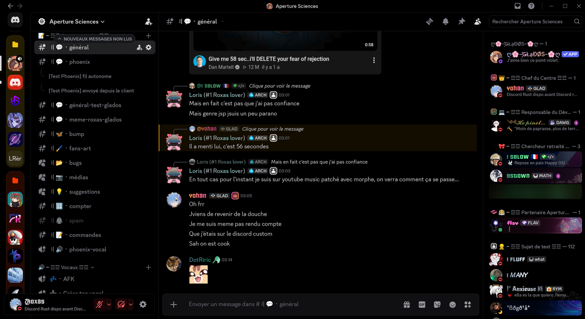</a><br><sub>#général on Aperture Sciences: role colours and gradients, replies, badges, YouTube embed and the member list.</sub></td>
<td width="50%" valign="top"><a href="docs/screenshots/2026-11-25/chat-phoenix-sandbox.png">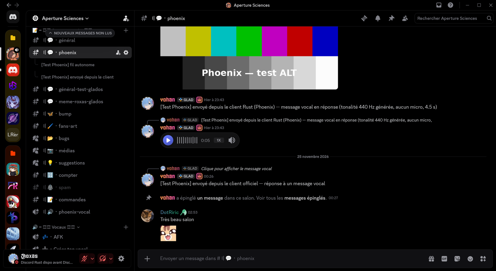</a><br><sub>#phoenix, the test channel: an image with ALT text, a voice message reply, a pin notice and a sticker.</sub></td>
</tr>
<tr>
<td width="50%" valign="top"><a href="docs/screenshots/2026-11-25/pending-message.png">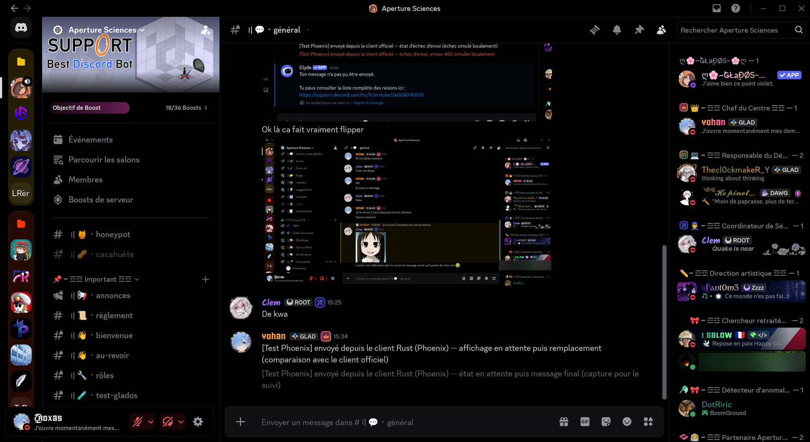</a><br><sub>A message being sent: the pending state in grey, then the final message, next to a Clyde error notice.</sub></td>
<td width="50%" valign="top"><a href="docs/screenshots/2026-11-25/poll.png">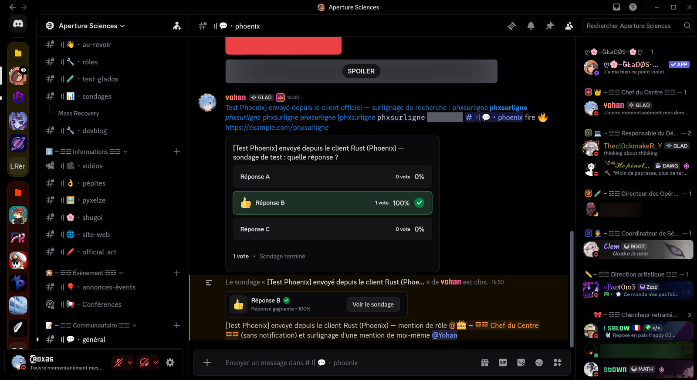</a><br><sub>A finished poll with the winning answer, and the "poll is closed" system message.</sub></td>
</tr>
<tr>
<td width="50%" valign="top"><a href="docs/screenshots/2026-11-25/attachment-alt-badge.png">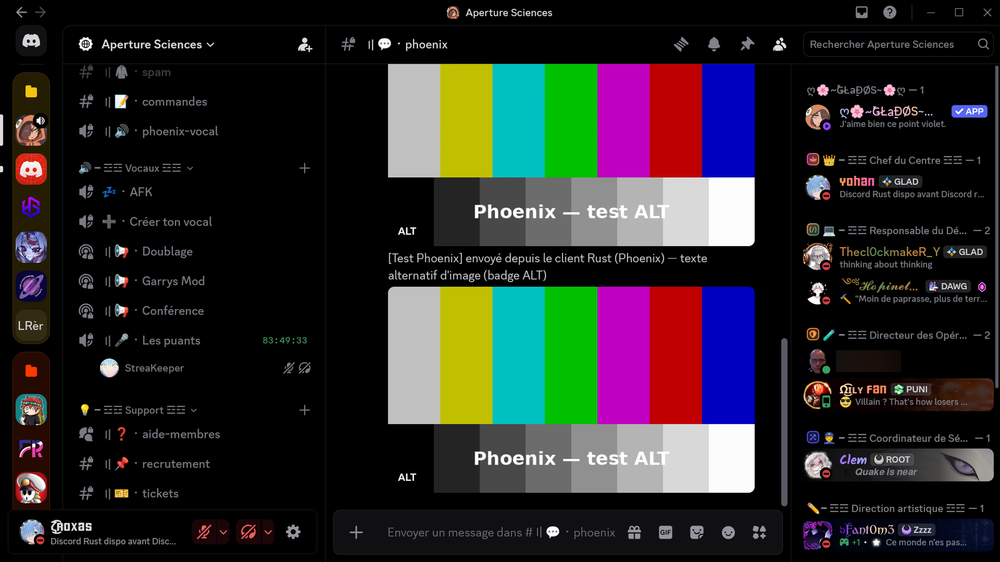</a><br><sub>Image attachments with the ALT badge for their description.</sub></td>
<td width="50%" valign="top"><a href="docs/screenshots/2026-11-25/attachment-alt-edit.png">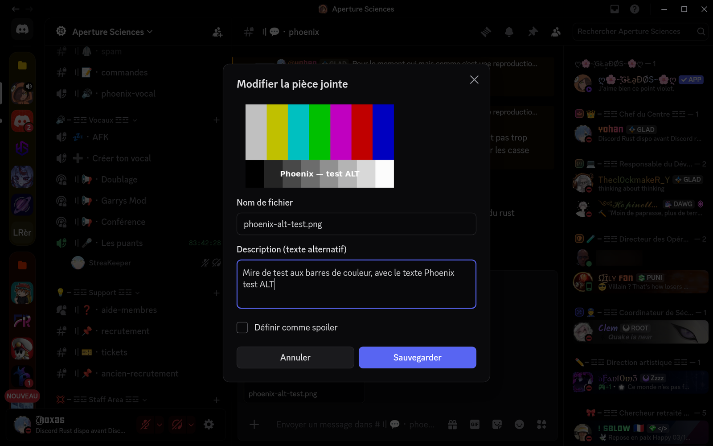</a><br><sub>Editing an attachment before sending: file name, ALT text and spoiler.</sub></td>
</tr>
<tr>
<td width="50%" valign="top"><a href="docs/screenshots/2026-11-25/voice-message-player.png">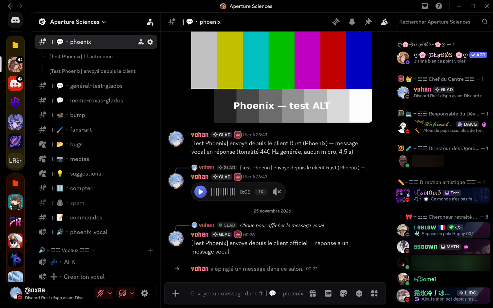</a><br><sub>The voice message player, muted, with the waveform and speed button.</sub></td>
<td width="50%" valign="top"><a href="docs/screenshots/2026-11-25/invite-cards.png">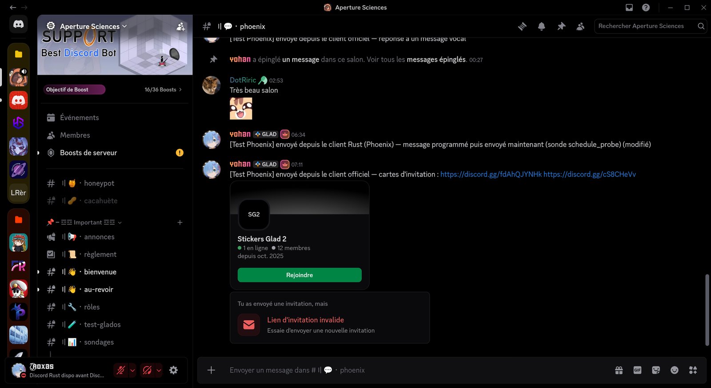</a><br><sub>Invite links drawn as invite cards, including the invalid invite card.</sub></td>
</tr>
<tr>
<td width="50%" valign="top"><a href="docs/screenshots/2026-11-25/emoji-picker-popular.png">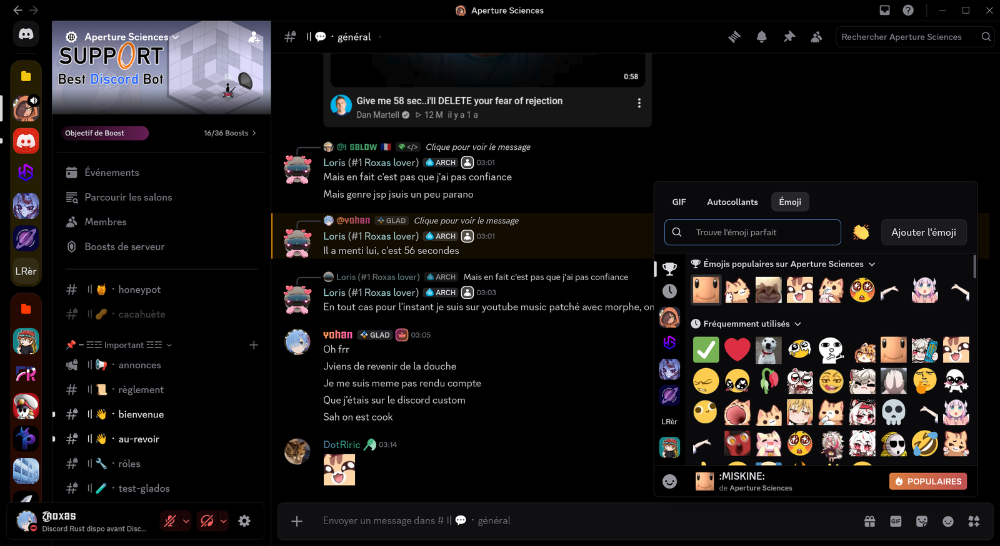</a><br><sub>The emoji picker with the server's popular emojis and the frequently used row.</sub></td>
<td width="50%" valign="top"><a href="docs/screenshots/2026-11-25/scheduled-message-calendar.png">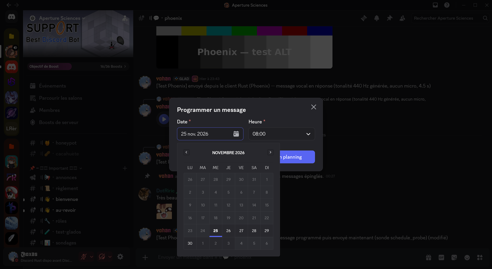</a><br><sub>Scheduling a message: the date picker and time list.</sub></td>
</tr>
</table>

### Members & profiles

<table>
<tr>
<td width="50%" valign="top"><a href="docs/screenshots/2026-11-25/member-list-nameplates.png">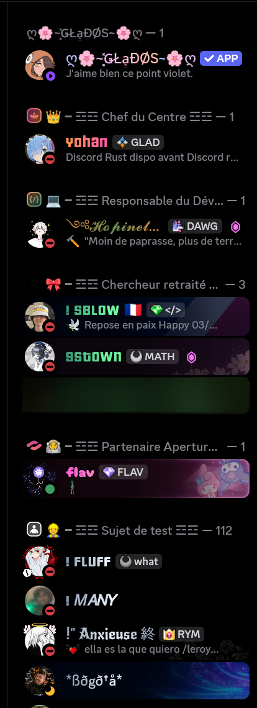</a><br><sub>The member list with role groups, role icons, activities and nameplates.</sub></td>
</tr>
</table>

### Search & inbox

<table>
<tr>
<td width="50%" valign="top"><a href="docs/screenshots/2026-11-25/search-results.png">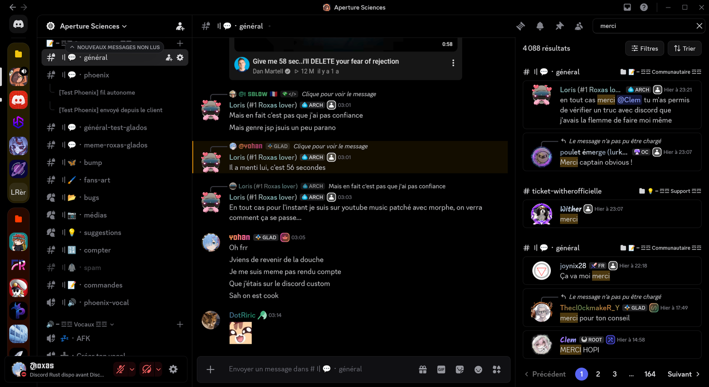</a><br><sub>Server search: result cards with highlighted hits, pagination, filters and sort.</sub></td>
<td width="50%" valign="top"><a href="docs/screenshots/2026-11-25/search-filters.png">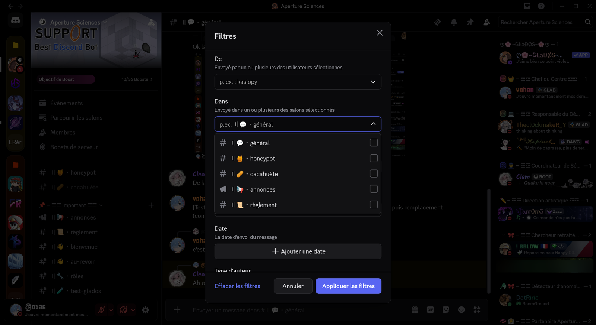</a><br><sub>The search filters modal with the channel picker open.</sub></td>
</tr>
<tr>
<td width="50%" valign="top"><a href="docs/screenshots/2026-11-25/inbox-unreads.png">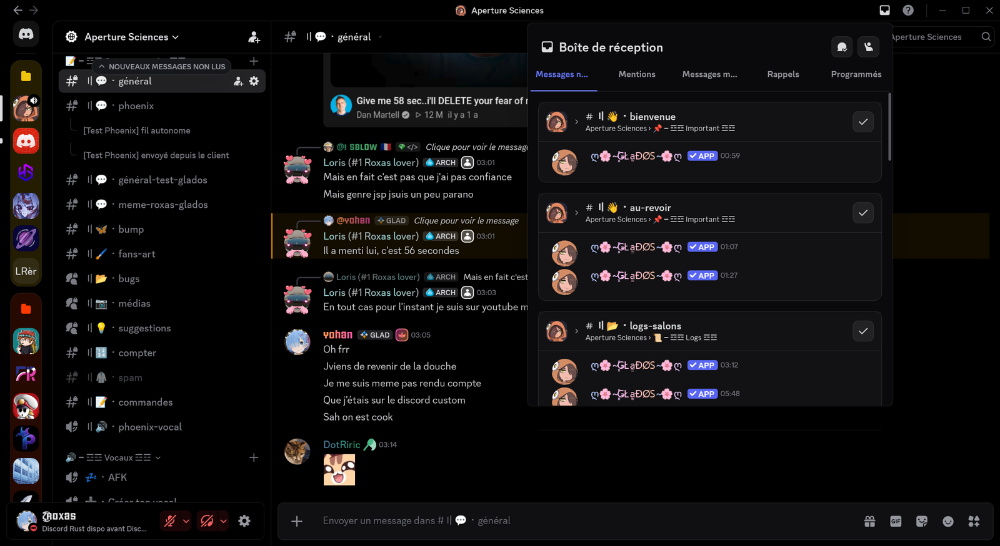</a><br><sub>The inbox, Unreads tab: cards per channel with mark-as-read buttons.</sub></td>
<td width="50%" valign="top"><a href="docs/screenshots/2026-11-25/scheduled-messages-inbox.png">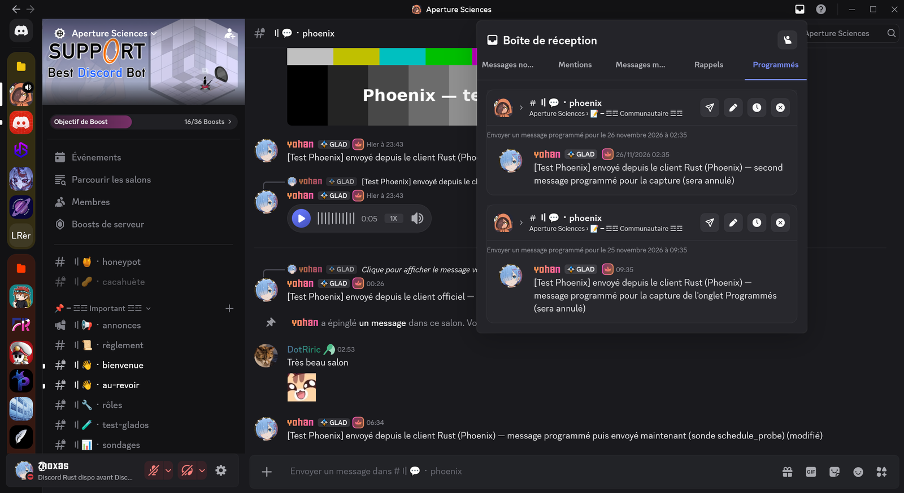</a><br><sub>The inbox, Scheduled tab: messages waiting to be sent, with send, edit, reschedule and cancel.</sub></td>
</tr>
</table>

### Threads & forums

<table>
<tr>
<td width="50%" valign="top"><a href="docs/screenshots/2026-11-25/threads-browser.png">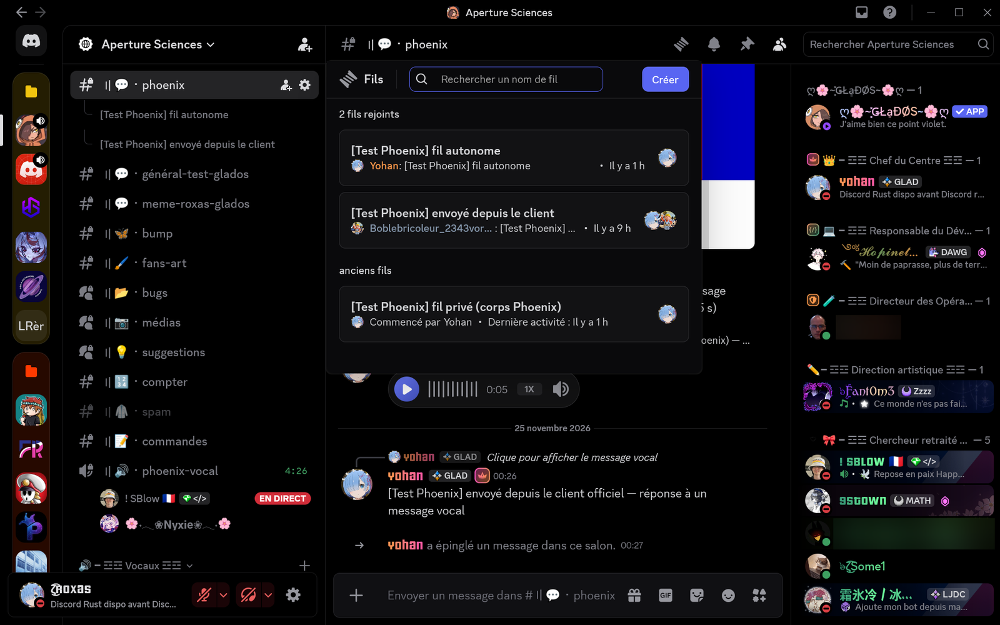</a><br><sub>The threads popout: joined threads with their last message, and older threads.</sub></td>
<td width="50%" valign="top"><a href="docs/screenshots/2026-11-25/forum-guidelines.png">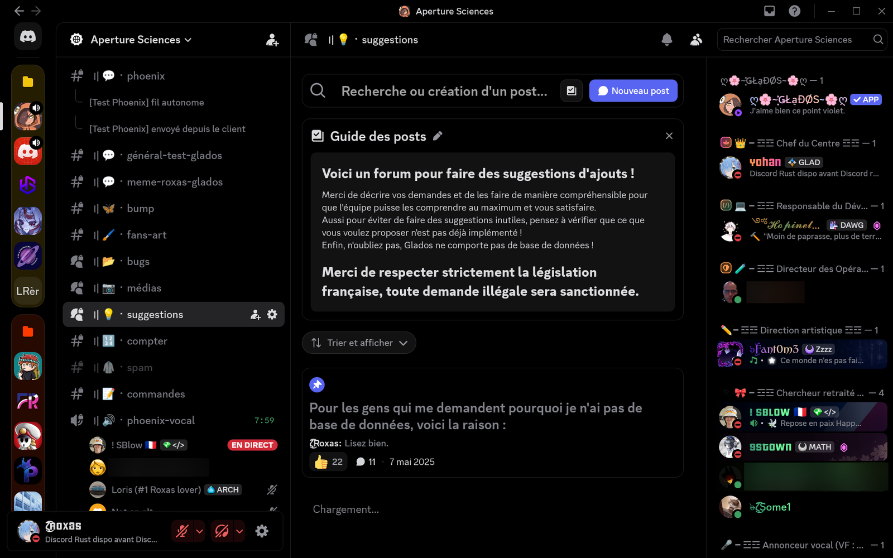</a><br><sub>A forum channel with its post guidelines, sort menu and a pinned post.</sub></td>
</tr>
</table>

### Voice

<table>
<tr>
<td width="50%" valign="top"><a href="docs/screenshots/2026-11-25/voice-call.png">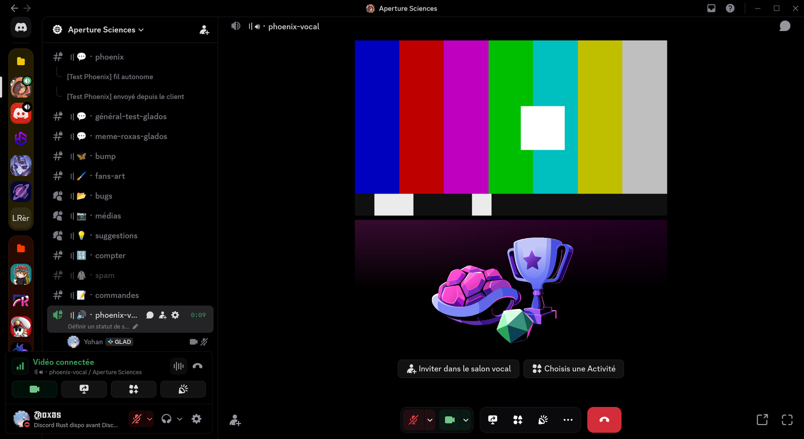</a><br><sub>In the test voice channel: Phoenix sending a test pattern as camera video.</sub></td>
<td width="50%" valign="top"><a href="docs/screenshots/2026-11-25/soundboard.png">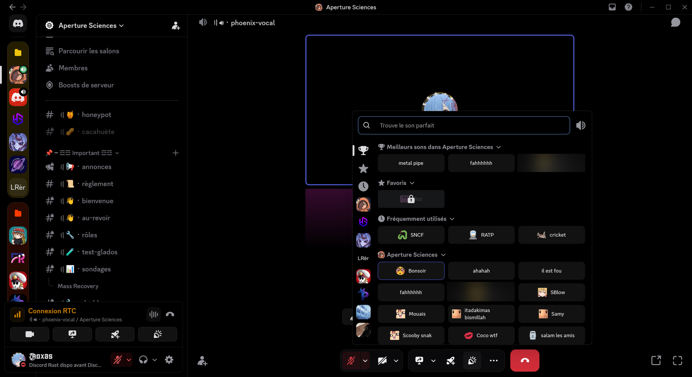</a><br><sub>The soundboard: top sounds, favourites, recent sounds and the server's sounds.</sub></td>
</tr>
<tr>
<td width="50%" valign="top"><a href="docs/screenshots/2026-11-25/go-live-modal.png">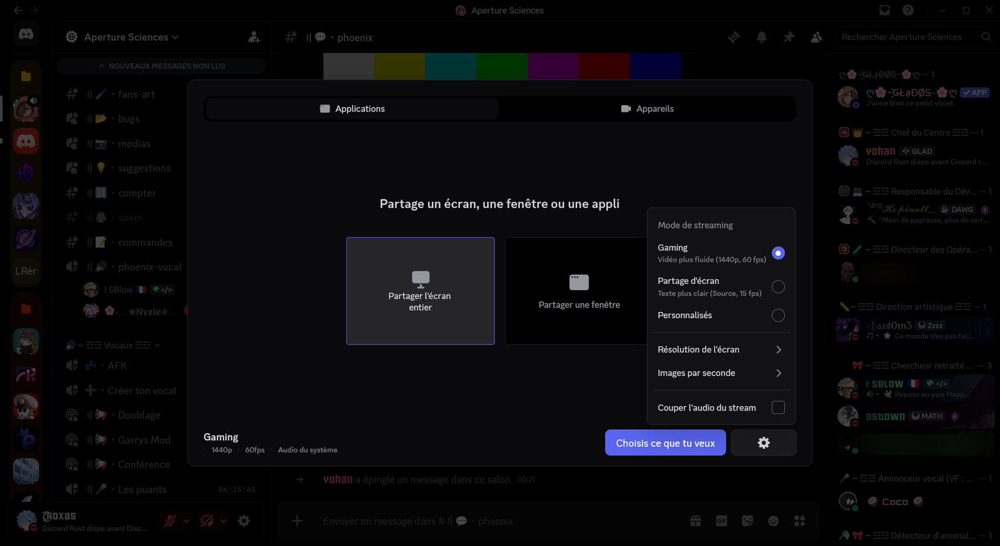</a><br><sub>Go Live: the screen picker with the streaming mode menu.</sub></td>
<td width="50%" valign="top"><a href="docs/screenshots/2026-11-25/go-live-streaming.png">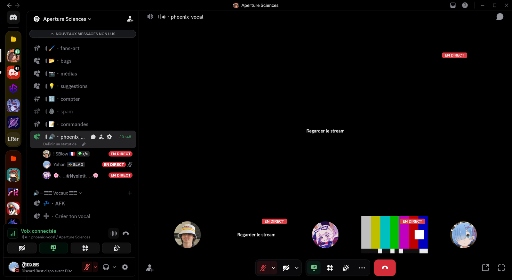</a><br><sub>Phoenix streaming in the test voice channel (other streams stay behind "Watch stream").</sub></td>
</tr>
</table>

### User settings

<table>
<tr>
<td width="50%" valign="top"><a href="docs/screenshots/2026-11-25/settings-appearance.png">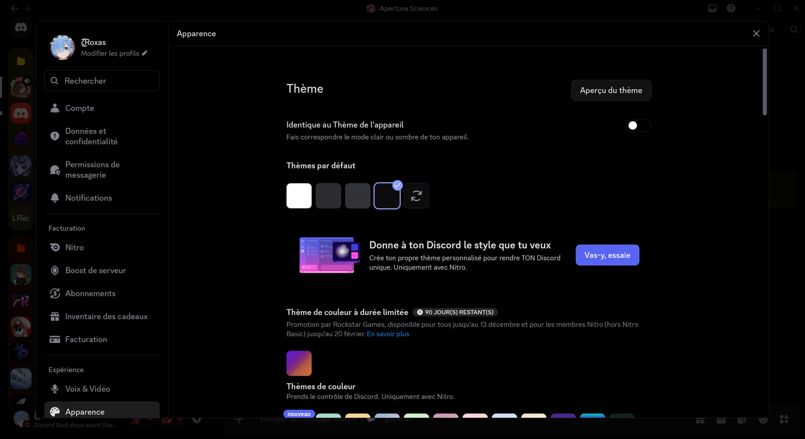</a><br><sub>Settings › Appearance: default themes, the device theme switch and colour themes.</sub></td>
<td width="50%" valign="top"><a href="docs/screenshots/2026-11-25/settings-voice-video.png">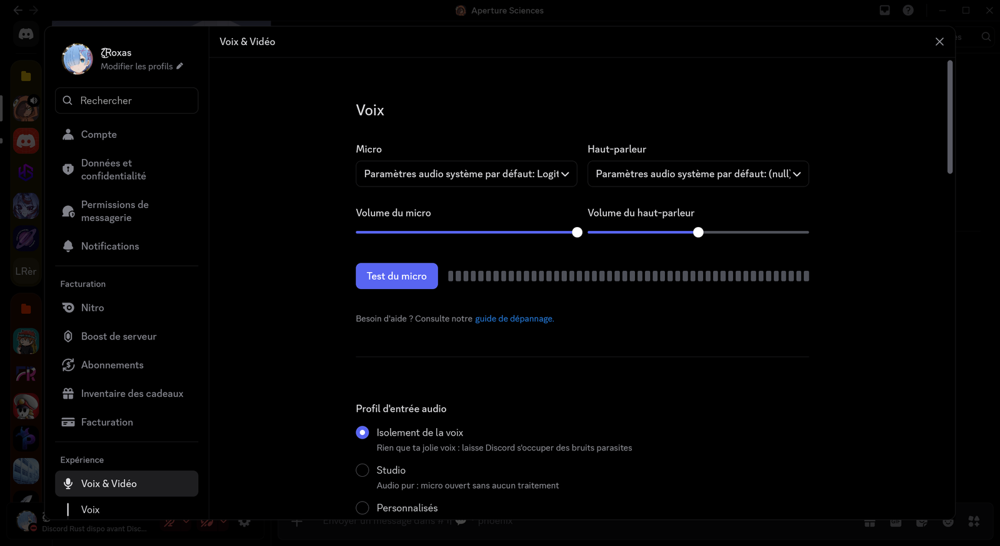</a><br><sub>Settings › Voice & Video: devices, volumes, mic test and input profile.</sub></td>
</tr>
<tr>
<td width="50%" valign="top"><a href="docs/screenshots/2026-11-25/settings-notifications.png">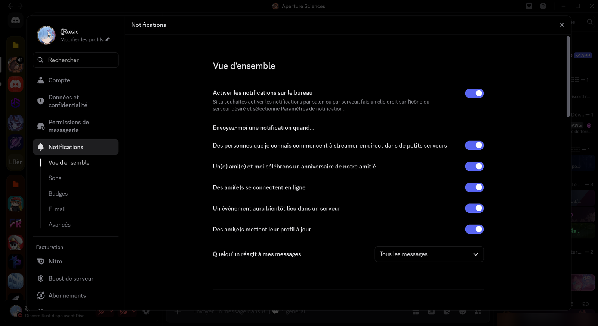</a><br><sub>Settings › Notifications: the overview switches and their sub-pages.</sub></td>
<td width="50%" valign="top"><a href="docs/screenshots/2026-11-25/streamer-mode.png">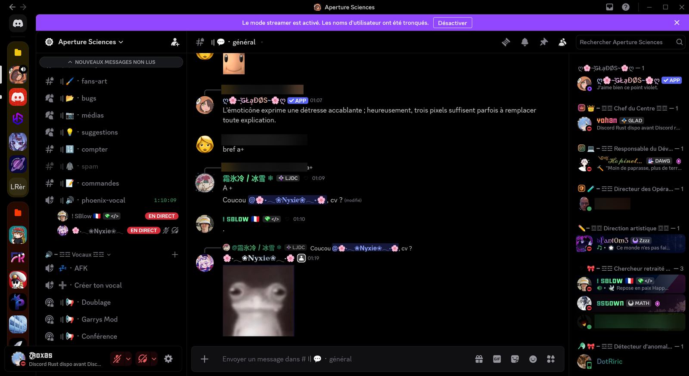</a><br><sub>Streamer mode on: the banner and hidden usernames, read from the account's settings.</sub></td>
</tr>
</table>

### Server & channel settings

<table>
<tr>
<td width="50%" valign="top"><a href="docs/screenshots/2026-11-25/server-settings-profile.png">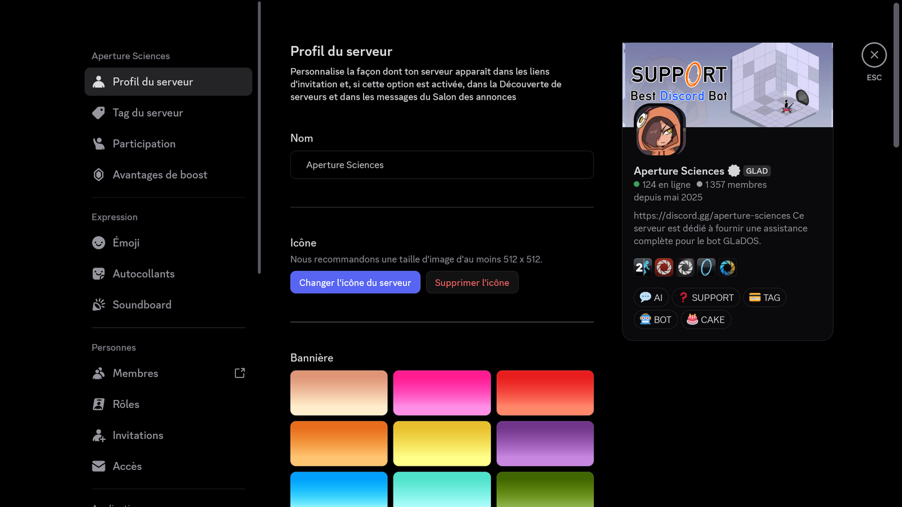</a><br><sub>Server settings › Server profile with the live invite preview card.</sub></td>
<td width="50%" valign="top"><a href="docs/screenshots/2026-11-25/server-settings-roles.png">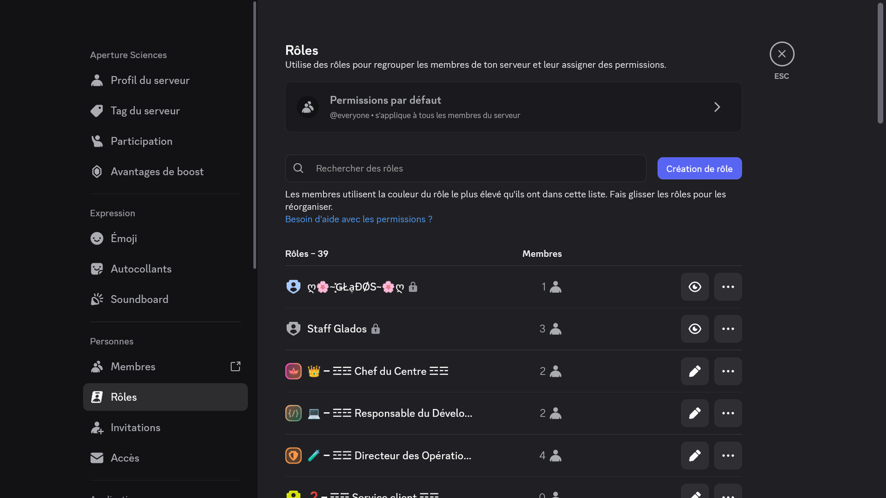</a><br><sub>Server settings › Roles: default permissions, search and the role list.</sub></td>
</tr>
<tr>
<td width="50%" valign="top"><a href="docs/screenshots/2026-11-25/server-settings-safety.png">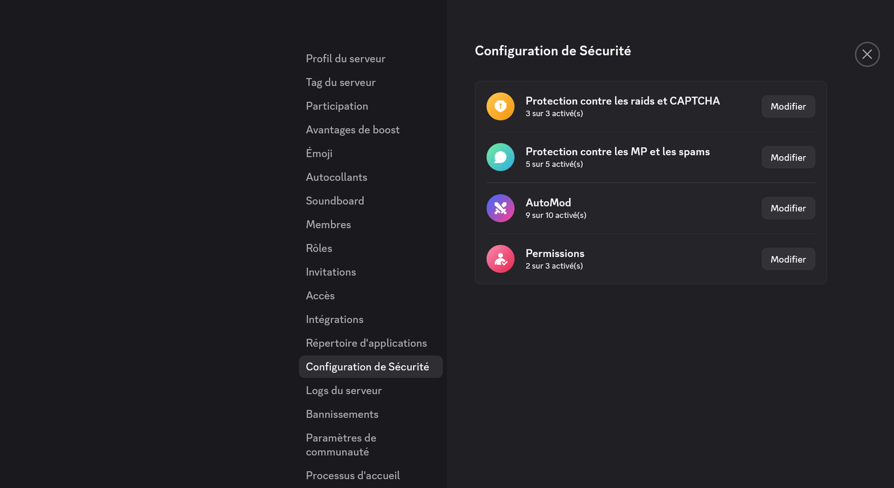</a><br><sub>Server settings › Safety setup.</sub></td>
<td width="50%" valign="top"><a href="docs/screenshots/2026-11-25/server-settings-automod.png">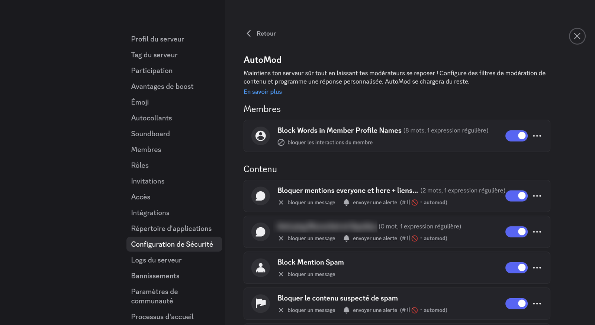</a><br><sub>Server settings › AutoMod rules.</sub></td>
</tr>
<tr>
<td width="50%" valign="top"><a href="docs/screenshots/2026-11-25/channel-settings-permissions.png">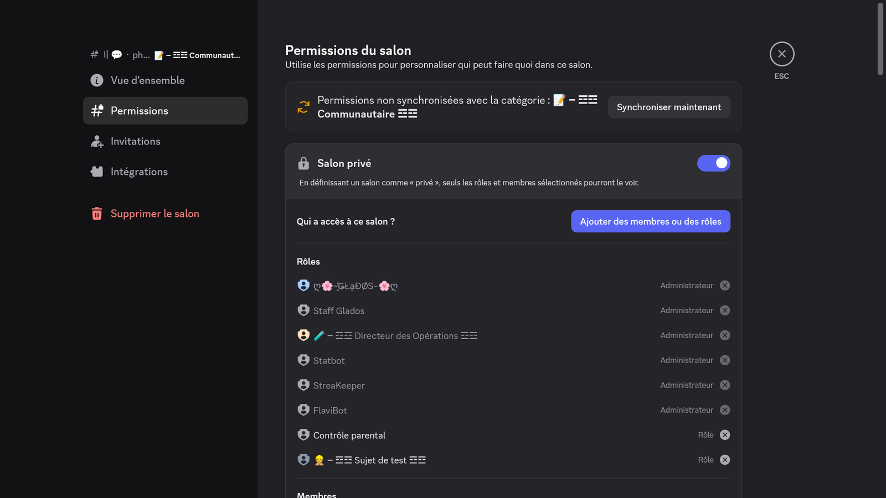</a><br><sub>Channel settings › Permissions of #phoenix: private channel and who has access.</sub></td>
<td width="50%"></td>
</tr>
</table>

### Moderation & safety

<table>
<tr>
<td width="50%" valign="top"><a href="docs/screenshots/2026-11-25/report-flow.png">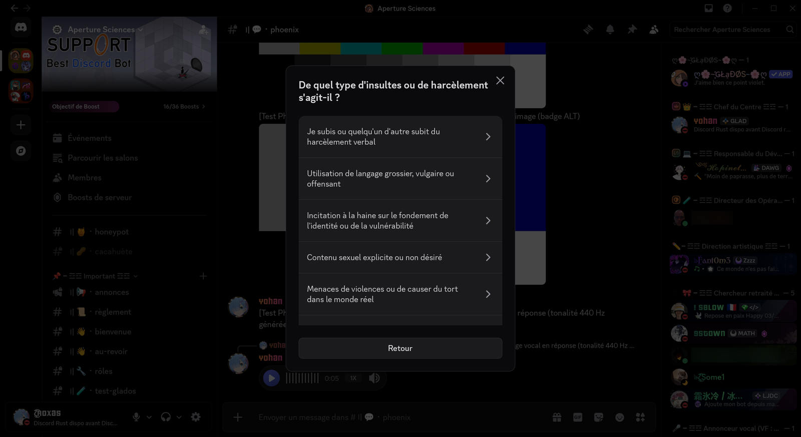</a><br><sub>Reporting a message: the multi-step report flow (nothing was sent).</sub></td>
<td width="50%"></td>
</tr>
</table>

### Home

<table>
<tr>
<td width="50%" valign="top"><a href="docs/screenshots/2026-11-25/quests.png">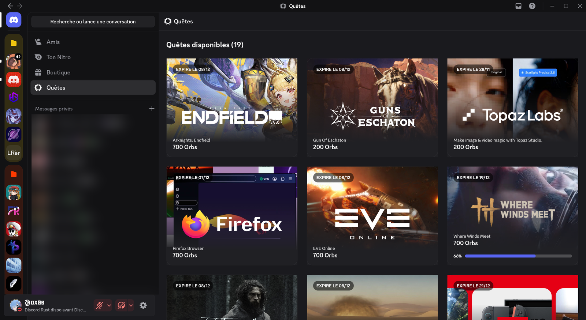</a><br><sub>The Quests page, read from the account's quests (the DM list is blurred).</sub></td>
<td width="50%"></td>
</tr>
</table>

How we check parity: every view is compared against the official 2026 client on the same account, at the same window size and zoom. We measure the CSS, the states (hover, focus, pressed, open menus) and the window widths at which the layout changes. The method is in [docs/PARITY_WORKFLOW.md](docs/PARITY_WORKFLOW.md), and each area has a status table in [docs/parity/](docs/parity/), with ✅, ⚠ and ❌ and the source of each value.

## Benchmarks

First measurements (i7-6700K, GTX 1050 Ti, 32 GB, Wayland). Discord Phoenix ran on **mock data**,
while the official client was measured read-only on a **real account**, so treat this as an
order of magnitude. Full method and caveats: [docs/BENCHMARKS.md](docs/BENCHMARKS.md).

| | Discord Phoenix (mock) | Official Discord 1.0.170 |
|---|---|---|
| Idle memory (PSS) | ~140–195 MiB, 1 process | ~805 MiB, 10 processes |
| Idle CPU | ~0.3 % of one core | ~2.2 % |
| Start to first frame | ~0.5 s warm, 1.2 s cold | — |
| 5000-message channel | +14 MiB after loading and scrolling it all | — |
| Binary | 42 MiB, single stripped file | Electron |

Reproduce with `scripts/bench/run.sh`.

## Installing

Prebuilt beta builds for Linux (AppImage, `.deb`, tarball), Windows and macOS are attached to
[releases](https://github.com/RoxasYTB/project-phoenix/releases). macOS builds are not notarized:
right-click the app and choose **Open** the first time.

## Building from source

Requires a recent stable Rust toolchain (`rustup`).

```sh
git clone https://github.com/RoxasYTB/project-phoenix
cd project-phoenix
cargo run -p phoenix-app --release
```

**Linux** also needs these development packages (Debian/Ubuntu names):

```sh
sudo apt install pkg-config libxkbcommon-dev libxkbcommon-x11-dev libwayland-dev \
  libvulkan-dev libxcb1-dev libfontconfig-dev libssl-dev libasound2-dev
```

**macOS** needs the Xcode command line tools. **Windows** needs the MSVC build tools.

## Project layout

| Crate | Purpose |
|---|---|
| [`phoenix-api`](crates/phoenix-api) | Data models, REST client with rate limiting, gateway connection, state cache |
| [`phoenix-voice`](crates/phoenix-voice) | Voice gateway, UDP/RTP transport, encryption, codec negotiation, DAVE |
| [`phoenix-app`](crates/phoenix-app) | The GPUI desktop application |

## Privacy and security

Your token is only ever sent to Discord. The client has no telemetry and no analytics.
See [SECURITY.md](SECURITY.md) for how credentials are handled and how to report a vulnerability.

## Contributing

Contributions are welcome, from a one-pixel fix to a whole feature. Please read [CONTRIBUTING.md](CONTRIBUTING.md) first; the parity tables in [docs/parity/](docs/parity/) show what is missing and how each value was measured. In short: everything is
aimed at 1:1 parity with the official client. The real client's CSS, behaviour and assets are the reference.
Binary assets are loaded from your local Discord install and are not shipped in this repository.

## License

Licensed under either of [Apache License 2.0](LICENSE-APACHE) or [MIT License](LICENSE-MIT), at your option.
